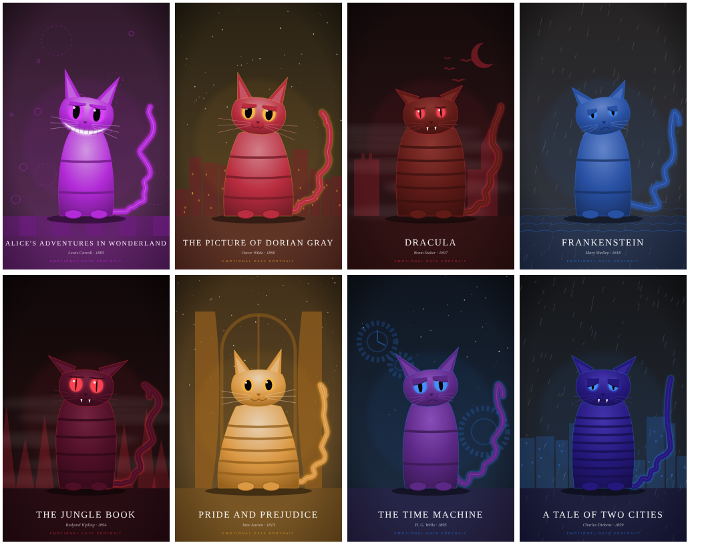
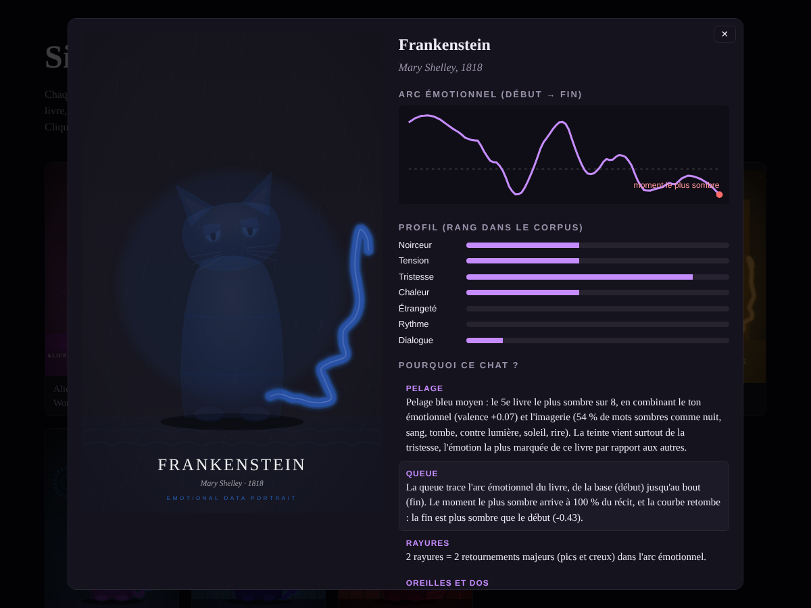

# Si ce livre était un chat

Chaque chat est **dessiné par du code** à partir de l'analyse complète d'un roman du domaine public. Rien n'est choisi à la main : la couleur du pelage, la forme de la queue, les yeux, les oreilles et le décor viennent tous du texte, et chaque trait est expliqué.



La galerie (`output/index.html`) montre, pour chaque chat, l'arc émotionnel du livre, son profil, et **pourquoi** il ressemble à ça. Au survol d'une explication, la partie du chat concernée s'allume.



## Comment ça marche

```
Livre (Gutenberg) → émotions sur tout le texte → profil relatif au corpus → ADN du chat → SVG → galerie
```

1. **Données.** Chaque livre est fixé par son identifiant Project Gutenberg, téléchargé une seule fois, nettoyé (en-tête et licence retirés) puis **validé** : un fichier vide ou le mauvais livre déclenche une erreur au lieu d'être analysé en silence.
2. **Émotions.** Le texte est découpé en segments d'environ 1 500 mots. Dans chaque segment, on compte les mots d'émotion du lexique **NRC** (peur, colère, tristesse, joie, surprise, dégoût, confiance). Les noms propres en milieu de phrase et une liste de mots ambigus (« found », « white », « mother »…) sont ignorés.
3. **Arc émotionnel.** La valence (positif − négatif) de chaque segment donne une courbe, lissée par un filtre de Savitzky-Golay. Ses pics et creux marqués sont les **retournements** du récit.
4. **Style et décor.** Longueur des phrases, part de dialogue, exclamations, imagerie sombre ou lumineuse (nuit, sang, tombe contre soleil, aube, rire), et familles de mots de décor (gothique, mer, nature sauvage, ville, salon, merveilleux, science).
5. **ADN.** Chaque mesure est convertie en **rang dans le corpus** : le livre le plus sombre a toujours le chat le plus sombre, même si les scores bruts sont proches.
6. **Dessin.** Un SVG construit par calques, avec des paramètres continus.

| Ce que mesure le livre | Ce que ça change sur le chat |
|---|---|
| Arc émotionnel | **la forme de la queue** (base = début du livre, bout = fin) |
| Fin plus lumineuse / plus sombre que le début | bout de la queue qui remonte / retombe |
| Nombre de retournements du récit | nombre de rayures |
| Noirceur (valence + imagerie sombre) | luminosité du pelage et du ciel |
| Émotion la plus marquée | teinte du pelage et couleur des yeux |
| Tension (peur + colère) | oreilles couchées, dos rond, pupilles en fente |
| Tristesse | paupières tombantes, moustaches basses, pluie |
| Chaleur (joie + confiance) | silhouette plus ronde, sourire |
| Étrangeté (surprise + merveilleux) | grands yeux, sourire du chat du Cheshire |
| Part de dialogue | longueur des moustaches |
| Vocabulaire de décor | décor de fond |
| Année de publication | voile sépia |

## Lancer le projet

```bash
python -m venv .venv
source .venv/bin/activate            # Windows : .venv\Scripts\activate
pip install -e ".[dev]"

bookcats                             # les 10 livres : télécharge, analyse, dessine
bookcats dracula alice frankenstein  # seulement certains livres (2 minimum)
pytest                               # les tests
```

Puis ouvrir `output/index.html` dans un navigateur.

L'analyse prend quelques secondes en tout. Les livres et les analyses sont mis en cache dans `data/` ; `bookcats --force` recalcule tout.

**Option : modèle Transformer.** `pip install -e ".[transformer]"` puis `bookcats --backend transformer` utilise `j-hartmann/emotion-english-distilroberta-base` à la place du lexique. Plus lent, mais il comprend le contexte (négations, ironie).

## Structure

```
src/bookcats/
  catalog.py    les livres et leurs identifiants Gutenberg
  fetch.py      téléchargement, nettoyage, validation
  segment.py    découpage en segments de taille égale
  emotions.py   lexique NRC (défaut) ou Transformer
  style.py      style, imagerie, décor
  features.py   tout ce qu'on mesure sur un livre (mis en cache en JSON)
  dna.py        rangs dans le corpus → ADN du chat + explications
  draw.py       ADN → SVG
  gallery.py    page HTML autonome
  pipeline.py   la commande `bookcats`
tests/          13 tests (nettoyage, découpage, lexique, cohérence des traits, queue dans le cadre…)
```

## Limites connues

- **Un lexique ne comprend pas le contexte** : « not happy » compte comme de la joie, et l'ironie lui échappe. Les livres riches en formules de politesse (les lettres de *Dracula*) paraissent plus positifs qu'ils ne le sont. C'est pour ça que la noirceur combine la valence et l'imagerie, et que le backend Transformer existe.
- **Tout est relatif au corpus** : ajouter ou retirer un livre peut changer les autres chats. C'est voulu : un chat dit « ce livre est plus sombre que les autres », pas « ce livre est sombre dans l'absolu ».
- **Livres en anglais uniquement** pour l'instant.

## Prochaines étapes

- **Évaluation humaine** : montrer un chat et trois titres, et mesurer si les gens retrouvent le bon livre plus souvent que le hasard (33 %), avec un groupe contrôle de chats à ADN aléatoire.
- Comparer lexique et Transformer sur le même corpus.
- Un outil MCP `book_to_cat(titre)` pour générer un chat depuis Claude ou Cursor.

Textes : [Project Gutenberg](https://www.gutenberg.org). Lexique : [NRC Emotion Lexicon](https://saifmohammad.com/WebPages/NRC-Emotion-Lexicon.htm) (Saif Mohammad et Peter Turney), via le paquet `nrclex`.
